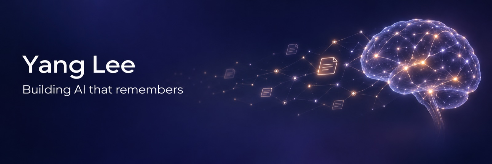

### Hi, I'm Yang Lee 👋

I build AI that remembers. My research is on memory for LLM agents and brain-inspired AI; my work outside the lab is turning that into products and open tools.

**Now**
- 🧠 **Memory for agents**: [BMAM](https://github.com/innovation64/BMAM), a brain-inspired multi-agent memory framework
- 🌐 **Context from the environment**: [AURA](https://github.com/innovation64/AURA) turns environment signals into context an LLM can act on
- ❓ **Ambiguous questions**: [CondAmbigQA](https://github.com/innovation64/CondAmbigQA), conditional answers for ambiguous QA
- 🔥 **[Project Fireseed 火种计划](https://apocalypse-agi-dao.github.io)**: an open community that reads the AI frontier every week and builds open, self-hostable versions. Contributors welcome.

**Interests**: long-term memory · agents · neuro + AI (EEG/fMRI) · local and private AI · robotics

**Before**: AI + robotics startup · Hugging Face volunteer · BAAI-Link community co-builder · InnoX Academy

**Elsewhere**: [Fireseed Discord](https://discord.gg/tawyKmdNbS) · [X @innovation641](https://x.com/innovation641) · [LinkedIn](https://www.linkedin.com/in/yang-lee-098414203/) · [Blog](https://innovation64.github.io/) · [Kaggle](https://www.kaggle.com/aikiller)

> “We believe that innovative authors are more likely to come from people who are independent and won’t work in a software ‘factory’ or ‘bureaucracy.’”
> — Steven Levy, *Hackers*

